<p align="center">
  <a href="https://github.com/wtg-codes/agy-box/actions/workflows/ci.yml">
    
  </a>
  <a href="https://github.com/wtg-codes/agy-box/releases">
    
  </a>
  <a href="https://wtg-codes.github.io/agy-box/">
    
  </a>
  
  
  <a href="LICENSE">
    
  </a>
</p>

# 📦 Antigravity Dev Box (agy-box)

agy-box is agy and friends in a box of your choice! This repository builds the `agy-box`, the Distrobox workspace container for the `bluefin-wtg` ecosystem: a host-integrated Ubuntu 24.04 LTS sandbox (`quay.io/toolbx/ubuntu-toolbox:24.04`, digest-pinned, native `linux/amd64` and `linux/arm64`) with the complete Google Antigravity agent toolchain, modern IDEs, Chrome, and a browser-based VDI desktop pre-baked. It runs as an integrated workstation via Distrobox (Bluefin and other Universal Blue hosts are first-class) or as an isolated rootless Podman/Docker sandbox.

The published container image is **`ghcr.io/wtg-codes/agy-box`** (`:latest` tracks `main`; releases are tagged `:<major>.<minor>.<patch>` and `:<major>.<minor>`, e.g. `:0.6.0` and `:0.6`).

> 🌐 **Project website: [wtg-codes.github.io/agy-box](https://wtg-codes.github.io/agy-box/)** — quick-start command, feature tour, architecture diagrams, and command reference.

---

## Quick Start (No Clone Required)

Launch the interactive workspace manager and install the environment directly from your terminal without cloning this repository:

```bash
bash -c "$(curl -fsSL https://raw.githubusercontent.com/wtg-codes/agy-box/main/agy-box-manager)"
```

*(From the interactive menu, simply select **"Install CLI Globally"** to save the tool to your system permanently!)*

### Bluefin / Universal Blue (Podman + Distrobox)

On **Bluefin, Bazzite, and Aurora**, Podman, Distrobox, and Homebrew are already there, so the full workflow is:

```bash
# 1. Install the manager (or use the one-liner above and pick "Install CLI Globally")
agy-box-manager install-global

# 2. Pull ghcr.io/wtg-codes/agy-box:latest and create the Distrobox workstation
agy-box-manager install

# 3. Work inside it (GUI apps render natively on your desktop), or use the browser VDI
agy-box-manager enter
agy-box-manager desktop      # then open http://localhost:6080/vnc.html?autoconnect=true&resize=scale
```

The `agy` CLI is exported to your host's `~/.local/bin`, so `agy --version` works straight from the host shell. If you cloned the repo, `just agy` opens the same interactive menu, and the `ujust agy-*` recipes are available through the Bluefin integration.

## Prerequisites

- **An x86_64 (amd64) or aarch64 (arm64) Linux host**: standard PCs/servers, NVIDIA DGX Spark workstations, Apple Silicon (Asahi Linux), and ChromeOS Crostini.
- **A container runtime**: **Podman** (recommended) or **Docker**.
- **Distrobox**: integrates the container with your host desktop (workstation mode).
- **Gum**: powers the interactive menu. If it is missing, the manager installs it via Homebrew when available, otherwise prints install instructions.

The manager does not install Podman, Docker, or Distrobox for you; see the [Setup & Troubleshooting Guide](docs/SETUP.md) for per-distro install commands.

## What's Inside

- **Google Antigravity app** (`antigravity`, 2.0.1) — the agent-first UI.
- **Antigravity CLI** (`agy`), **Antigravity SDK** (`google-antigravity`), **Google ADK** (`adk`), and **Gemini CLI** (`gemini`).
- **VS Code** and **Zed** with Antigravity extensions pre-configured; **JetBrains** IntelliJ IDEA / PyCharm on demand via `agy-install-ide`.
- **Google Chrome** (amd64) / **Chromium** (arm64) for CDP browser automation.
- **CNCF tooling**: `kubectl`, `helm`, `k9s` (pinned, checksum-verified).
- **IceWM noVNC VDI desktop** (`agy-vdi`) on port `6080`.
- **First-run setup assistant** (`agy-setup-helper`): keyring, API keys, Chrome, Git identity, and security audits.

The toolchain is baked system-wide into `/opt` and `/usr/local/bin` at build time (so the Syft SBOM is complete) and can be updated per user with `agy-install-toolchain`.

## Architecture

agy-box runs via **Distrobox** with an isolated home (`~/.config/agy-box/home`), read-only mounts of your `~/.ssh`, `~/.config/gcloud`, and `~/.gitconfig`, and forwarded Wayland/X11, D-Bus keyring, and audio sockets. Named boxes can instead run as fully isolated rootless Podman/Docker sandboxes (`--mode sandbox`).



See the [System Architecture Guide](docs/architecture/system-architecture.md) for the bridging model, keyring pipeline, port map, image composition, and CI/CD pipeline.

## Commands

| Action | Command | Just |
| :--- | :--- | :--- |
| Interactive menu | `agy-box-manager` | `just agy` |
| Install / update the official box | `agy-box-manager install [-n <name>] [-i ] [--enter]` | `just agy-install` |
| Enter a box | `agy-box-manager enter [name\|dev]` | `just agy-enter` |
| Start the VDI web desktop | `agy-box-manager desktop [name\|dev] [-p port]` | `just agy-desktop` |
| Status of all boxes & storage | `agy-box-manager status` | `just agy-status` |
| Health checks & component inventory | `agy-box-manager doctor` (alias `check`) | `just agy-check` |
| Update toolchain, IDE extensions & packages | `agy-box-manager update [name\|dev] [--all\|--check]` | `just agy-update` |
| Remove a box | `agy-box-manager clean [name\|dev] [--purge\|--keep]` | `just agy-clean` |

The full command reference (wizard, backup/restore, ports, dev builds, global install, side-by-side test boxes) is in the [User Guide](docs/USER_GUIDE.md#8-command-reference).

## Documentation

- 📘 **[User Guide](docs/USER_GUIDE.md)** — canonical handbook: setup, the 4 ways to work, IDEs, AI authentication, CLI mastery, maintenance, cloud deployments, and FAQ.
- 🛠️ **[Setup & Troubleshooting Guide](docs/SETUP.md)** — prerequisites, rootless engine configuration, PATH issues, keyring isolation.
- 🏛️ **[System Architecture Guide](docs/architecture/system-architecture.md)** — host bridging, D-Bus keyring, setup assistant flow, ports, CI/CD, and ADRs.
- ⚙️ **[Settings Reference](docs/settings-reference.md)** — Antigravity and CLI settings schema.
- 🤝 **[Contributing](CONTRIBUTING.md)** — repository layout, local development workflow, CI, releases, and GHCR maintenance.
- 🗺️ **[Roadmap / TODO](TODO.md)** and **[Changelog](CHANGELOG.md)**.
- 🌐 **[Project Website](https://wtg-codes.github.io/agy-box/)** (GitHub Pages, built from [`docs/index.html`](docs/index.html)).

## Testing

`just agy-test` builds `localhost/agy-box:dev` (skipped if nothing changed; `FORCE_BUILD=true` overrides), creates a temporary distrobox, and runs `scripts/assert-box.sh` against it. `just agy-e2e [tag]` runs the same harness against the published `ghcr.io/wtg-codes/agy-box:<tag>` image (default `latest`) including the VDI check, and `just test-scripts` runs the Bats unit tests for the install scripts. See [CONTRIBUTING.md](CONTRIBUTING.md#2-local-development-workflow) for the full workflow.

## License

[MIT](LICENSE)
