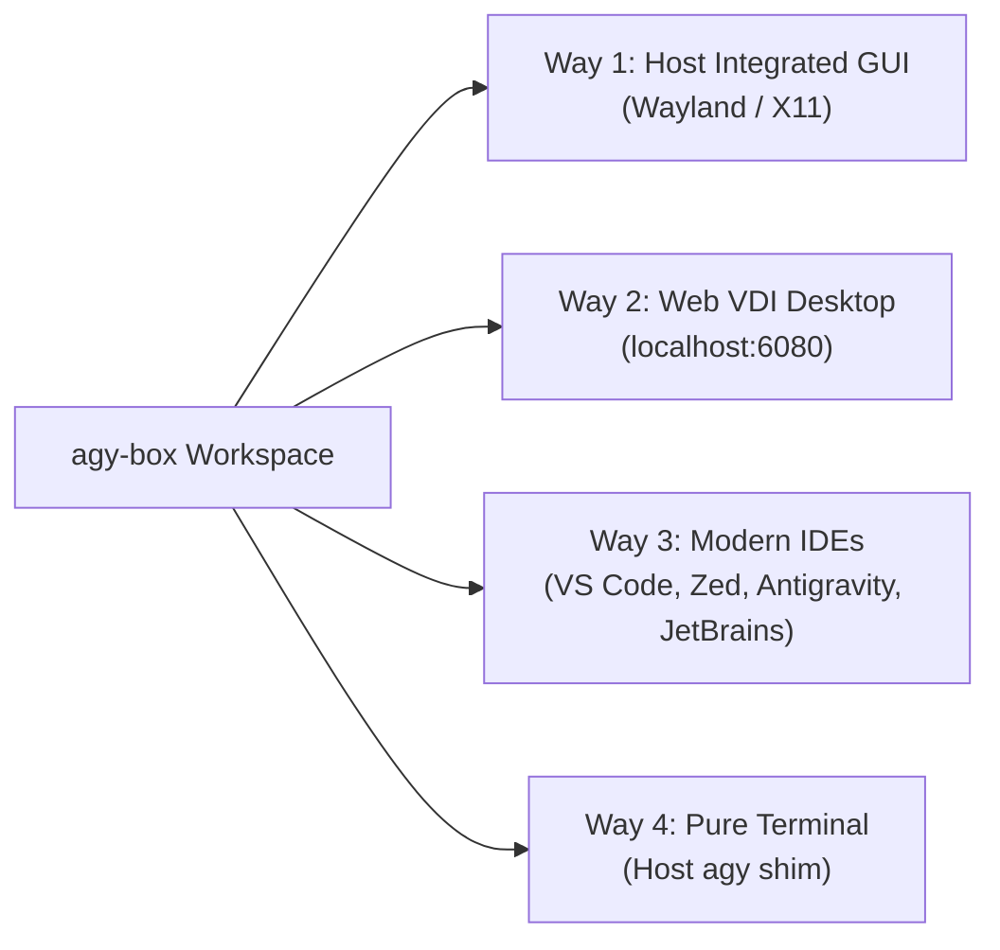

# 📘 Antigravity Dev Box (`agy-box`) — Complete User Guide

Welcome to the definitive user guide for **`agy-box`** (and companion **`agy-easy-install`**), the all-in-one AI agent development environment and sandbox for the Google Antigravity ecosystem.

Whether you are building autonomous agents with the **Antigravity SDK**, hacking with the **`agy` CLI**, building complex systems in **Visual Studio Code** or **Zed**, or testing workflows in the **Web VDI Desktop**, this guide walks you through every step.

---

## 📑 Table of Contents

1. [Quickstart (Zero-to-Hero in 60 Seconds)](#1-quickstart-zero-to-hero-in-60-seconds)
2. [The 4 Ways to Work](#2-the-4-ways-to-work)
   - [Way 1: Native Host Window Integration](#way-1-native-host-window-integration)
   - [Way 2: Browser-Based Web Desktop (noVNC VDI)](#way-2-browser-based-web-desktop-novnc-vdi)
   - [Way 3: Modern IDE Integration (VS Code, Zed, JetBrains)](#way-3-modern-ide-integration)
   - [Way 4: Pure Terminal Workflow & Host Shim](#way-4-pure-terminal-workflow--host-shim)
3. [AI Model Authentication & Setup](#3-ai-model-authentication--setup)
   - [Personal Google Account (OAuth)](#personal-google-account-oauth)
   - [Gemini API Key](#gemini-api-key)
   - [Enterprise / Google Cloud Vertex AI (GCP ADC)](#enterprise--google-cloud-vertex-ai-gcp-adc)
   - [Local Offline Models](#local-offline-models)
4. [Modern IDE Deep Dive](#4-modern-ide-deep-dive)
   - [Visual Studio Code & VSCodium](#visual-studio-code--vscodium)
   - [Zed Editor](#zed-editor)
   - [JetBrains IDEs (IntelliJ IDEA, PyCharm)](#jetbrains-ides-intellij-idea-pycharm)
5. [Agentic Engineering & CLI Mastery](#5-agentic-engineering--cli-mastery)
   - [The `agy` Command Reference](#the-agy-command-reference)
   - [Slash Commands Guide (`/plan`, `/boost`, `/teamwork-preview`)](#slash-commands-guide)
   - [Concurrent Subagents](#concurrent-subagents)
   - [Autonomous Browser Automation with Chrome CDP](#autonomous-browser-automation-with-chrome-cdp)
6. [Maintenance, Checking & Updating](#6-maintenance-checking--updating)
   - [First-Run Setup Wizard](#first-run-setup-wizard-wizard)
   - [Health Checks & Component Inventory](#health-checks--component-inventory-doctor)
   - [Updating the Environment](#updating-the-environment-update)
   - [Backing Up & Restoring Your Settings](#backing-up--restoring-your-settings-backup--restore)
7. [Troubleshooting & FAQ](#7-troubleshooting--faq)
8. [Command Reference](#8-command-reference)
9. [First-Time Setup Assistant](#9-first-time-setup-assistant)
10. [Alternative & Cloud Deployments](#10-alternative--cloud-deployments)
11. [Toolchain Reference](#11-toolchain-reference)

---

## 1. Quickstart (Zero-to-Hero in 60 Seconds)

You do **not** need to clone any Git repositories to install and launch `agy-box`.

### Step 1: Launch the Installer
Run this single command in your host terminal:

```bash
bash -c "$(curl -fsSL https://raw.githubusercontent.com/wtg-codes/agy-box/main/agy-box-manager)"
```

The manager script will automatically:
1. Verify host prerequisites (**Podman** or **Docker**, and **Distrobox**). It does not install them through your host package manager; if they are missing it prints install instructions (see the [Setup Guide](SETUP.md#quick-installation-guides)). `gum` is installed via Homebrew when available. On Bluefin / Universal Blue everything is already present.
2. Pull the multi-arch image (`ghcr.io/wtg-codes/agy-box:latest`) built natively for both Intel/AMD `x86_64` and ARM64 Apple Silicon / Grace Blackwell / Raspberry Pi.
3. Create your isolated sandbox with a dedicated home directory (`~/.config/agy-box/home`), mounting your `~/.ssh`, `~/.config/gcloud`, and `~/.gitconfig` safely as **read-only**.
4. Bootstrap the Antigravity agent toolchain (`agy`, IDE, UI, SDK, ADK, Gemini CLI) and export the `agy` command directly to your host's `~/.local/bin`.

### Step 2: Install the CLI Globally
Inside the interactive menu, select:
```text
🌍 Install CLI Globally (~/.local/bin)
```
Now you can run `agy-box-manager` and `agy` anywhere on your system!

---

## 2. The 4 Ways to Work

`agy-box` adapts to however you like to build:



### Way 1: Native Host Window Integration
If you are running a desktop Linux distribution (Fedora, Ubuntu, Arch, etc.):
```bash
agy-box-manager enter
```
Inside the container terminal, launching any GUI tool (such as `antigravity`, `code`, or `google-chrome-stable`) will render directly onto your host desktop as native Wayland or X11 application windows with GPU acceleration.

### Way 2: Browser-Based Web Desktop (noVNC VDI)
If you are on a remote server, cloud VM, iPad, Chromebook, or prefer a self-contained window:
```bash
agy-box-manager desktop
```
Open **`http://localhost:6080/vnc.html?autoconnect=true&resize=scale`** in any web browser. You will see a complete, lightweight IceWM desktop environment featuring:
* Antigravity wallpaper and dark theme
* Desktop shortcuts for **Google Antigravity (Agent UI)**, **VS Code**, **Zed**, **Antigravity CLI (`agy`)**, **Terminal**, and **Chrome**
* Taskbar with application menus and system tray

`agy-vdi` starts `Xvfb` (display `:99`, default `1920x1080`, override with `--resolution WxH`), `icewm-session`, `x11vnc` (bound to `127.0.0.1:5900`), and `websockify` (noVNC on port `6080`). Stale X11 and Chrome/Electron lock files from previous sessions are cleaned up automatically. Use `-p <port>` to run a second desktop on another port.

> [!WARNING]
> The noVNC gateway listens on all interfaces (`0.0.0.0:6080`) without password authentication. Restrict access with a firewall or an SSH tunnel when you are not on a trusted network.

### Way 3: Modern IDE Integration
Open your project files with your favorite editor or the Google Antigravity App directly inside the container:
```bash
# Launch VS Code with Google.antigravity pre-installed
code .

# Launch Zed Editor (high performance Rust editor)
zed .

# Launch Google Antigravity (Agent UI 2.0)
antigravity
```

### Way 4: Pure Terminal Workflow & Host Shim
You don't even need to type `distrobox enter` to run agents. `agy-box-manager` exports a host shim to `~/.local/bin/agy`:
```bash
# Run Antigravity CLI directly from your host shell:
agy --version
agy "Analyze this repo and generate a test suite"
```
The command automatically executes inside the sandboxed container and returns the output to your host terminal.

---

## 3. AI Model Authentication & Setup

`agy-box` supports all Google AI authentication models as well as local offline LLMs.

### Personal Google Account (OAuth)
The fastest way to get started with generous free-tier model quotas:
1. Inside the container (or via Web VDI), run:
   ```bash
   agy
   ```
2. When prompted, complete the one-time browser login.
3. Your authentication tokens are saved in your container's isolated home directory (`~/.gemini/` and `~/.config/Antigravity`).

### Gemini API Key
If you use a Google AI Studio API Key:
1. Export your key in your container shell or add it to `~/.config/environment.d/agy-box.conf`:
   ```bash
   export GEMINI_API_KEY="AIzaSy..."
   ```
2. The `agy-setup-helper` wizard automatically detects this key on startup.

### Enterprise / Google Cloud Vertex AI (GCP ADC)
If your organization uses Google Cloud Platform:
1. Run Google Cloud login inside the box:
   ```bash
   gcloud auth application-default login
   ```
2. Set your Google Cloud Project:
   ```bash
   export GOOGLE_CLOUD_PROJECT="my-enterprise-project-id"
   ```

### Local Offline Models
`agy-box` does not bundle a local model server or chat UI. Run your model backend (e.g. Ollama or vLLM) on the host or in its own container; the box shares the host network, so it is reachable on `localhost`. If you want a browser chat UI, run the official Open WebUI container next to the box: `podman run -d -p 3000:8080 -v open-webui:/app/backend/data ghcr.io/open-webui/open-webui:main`.

---

## 4. Modern IDE Deep Dive

### Visual Studio Code & VSCodium
* **Package Origin:** Official Microsoft repository (`packages.microsoft.com`) supporting both `amd64` and `arm64`.
* **Container Stability:** Pre-configured with container security wrappers (`--disable-dev-shm-usage --no-sandbox`).
* **Extension:** Comes pre-loaded with **`Google.antigravity`**.
* **Launch:** Click **Visual Studio Code** on the VDI Desktop or run:
  ```bash
  code .
  ```

### Zed Editor
* **Package Origin:** Official native binary from `zed-industries/zed`.
* **Extension:** Pre-configured with declarative extension management in `~/.config/zed/settings.json`:
  ```json
  {
    "auto_install_extensions": {
      "antigravity": true
    }
  }
  ```
* **Launch:** Click **Zed** on the VDI Desktop or run:
  ```bash
  zed .
  ```

### JetBrains IDEs (IntelliJ IDEA, PyCharm)
To keep the base container download fast, JetBrains IDEs (~2.5 GB) are installable on-demand with one command:
```bash
# Install IntelliJ IDEA Community Edition + Antigravity plugin:
agy-install-ide intellij

# Install PyCharm Community Edition + Antigravity plugin:
agy-install-ide pycharm
```
The installer downloads the community release into `$HOME/.local/share/JetBrains/`, creates desktop shortcuts, and registers the Antigravity plugin automatically.

---

## 5. Agentic Engineering & CLI Mastery

### The `agy` Command Reference

| Command / Flag | Purpose |
| :--- | :--- |
| `agy` | Start an interactive agent chat session |
| `agy -p "prompt"` | Run a one-shot headless agent prompt and print the answer |
| `agy --resume` | Resume the most recent conversation |
| `agy --statusline` | Customize the interactive terminal status line |
| `agy --sandbox` | Run in read-only sandbox mode (no disk modifications) |

### Slash Commands Guide

When working in an interactive session (`agy`), use slash commands to activate specialized agent behaviors:

* **`/plan`**: Formulates a detailed step-by-step implementation plan before touching code. Recommended for complex refactors.
* **`/boost`**: Activates deep multi-perspective reasoning for difficult bugs or architecture design.
* **`/teamwork-preview`**: Orchestrates a team of autonomous subagents working on parallel tasks.
* **`/learn`**: Teaches the agent a permanent preference or pattern to store in your project rules.
* **`/goal`**: Directs the agent to work persistently until a long-running objective is fully satisfied.

### Concurrent Subagents
The Antigravity engine can spawn autonomous background workers:
```text
> Please launch two subagents: one to audit security rules and one to write unit tests.
```
Subagents run in background branches, update their task logs, and alert you upon completion.

### Autonomous Browser Automation with Chrome CDP
`agy-box` ships with **Google Chrome** (`google-chrome-stable` on amd64, Chromium on arm64). AI agents can connect over the Chrome DevTools Protocol (port `9222`) to:
* Navigate web applications
* Inspect DOM and accessibility trees
* Capture screenshots and inspect network payloads
* Verify web frontend layouts autonomously

---

## 6. Maintenance, Checking & Updating

### First-Run Setup Wizard (`wizard`)
To configure or reconfigure your container runtime, keyring isolation mode, default IDE, and host profile seeding interactively:
```bash
agy-box-manager wizard
```
To initialize standard, rock-solid defaults non-interactively (e.g. in CI or unattended environments):
```bash
agy-box-manager wizard --defaults
```
All settings are persisted in `~/.config/agy-box/config.env`.

### Health Checks & Component Inventory (`doctor`)
To run health checks and inspect your entire environment in a unified diagnostic dashboard:
```bash
agy-box-manager doctor   # `agy-box-manager check` / `just agy-check` are aliases
```
This runs the health checks (PATH, connectivity, `~/.config` and `~/.local/bin` write permissions, container runtime, distrobox) and inspects:
* **Host OS & Kernel Architecture**: Distro version, CPU architecture (`x86_64` or `aarch64`).
* **Container Engine & Distrobox**: Active runtime (Podman vs Docker, rootless vs rootful status) and Distrobox version.
* **Workspace Containers**: Registration and run states for both `agy-box` (Official) and `agy-box-dev` (Dev).
* **Antigravity Toolchain**: `agy` CLI version, Python, Node.js, Google Cloud SDK (`gcloud`), and GitHub CLI (`gh`).
* **IDE Integrations**: Visual Studio Code, Zed Editor, and JetBrains with their Antigravity extension states.
* **Keyring & Authentication**: Active keyring backend (Host SecretService vs Air-gapped EncryptedKeyring), Google Cloud auth, GitHub login, and Antigravity tokens.

### Keyring Modes: Host vs. Isolated
`agy-box` supports two distinct credential storage profiles:
* **Host Mode (`AGY_KEYRING_MODE="host"`)**:
  Shares your host desktop's D-Bus Secret Service (GNOME Keyring / KWallet). Logins and tokens stored on your host machine are seamlessly accessible inside the container without re-authenticating.
* **Isolated Mode (`AGY_KEYRING_MODE="isolated"`)**:
  Completely unmaps the host D-Bus session bus (`--unsetenv=DBUS_SESSION_BUS_ADDRESS`) and configures a container-local `EncryptedKeyring` (`keyrings.alt.file.EncryptedKeyring`). All agent credentials, API tokens, and secrets remain securely quarantined inside `~/.config/agy-box/home/`.

### Updating the Environment (`update`)
Keep your agent toolchain, IDE extensions, and container OS packages up to date with a single command:
```bash
# Update everything (Toolchain, IDE extensions, Container packages)
agy-box-manager update

# Dry-run inspection (checks what would be updated)
agy-box-manager update --check

# Target specific components
agy-box-manager update --toolchain    # Updates agy CLI, IDE, UI, SDK, ADK, Gemini CLI
agy-box-manager update --ides         # Refreshes VS Code and Zed Antigravity extensions
agy-box-manager update --packages     # Upgrades Chrome, VS Code, and apt packages in box

# Update the dev workspace container instead of official
agy-box-manager update dev --all
```

### Backing Up & Restoring Your Settings (`backup` & `restore`)
Back up all your agent configurations, conversation transcripts, subagent brains, custom skills, rules, and IDE settings into a single compressed archive:

```bash
# Create an automatic timestamped backup (e.g. agy-box-backup-20261010-223000.tar.gz)
agy-box-manager backup

# Or specify a custom output path
agy-box-manager backup /path/to/my-backup.tar.gz
```

To restore your state on the same or a new machine:
```bash
# Restore interactively (with confirmation prompt)
agy-box-manager restore /path/to/my-backup.tar.gz

# Restore unattended / non-interactively
agy-box-manager restore /path/to/my-backup.tar.gz -y
```
The manager automatically validates archive integrity, restores your files into `~/.config/agy-box/`, and re-synchronizes rootless container permissions.

---

## 7. Troubleshooting & FAQ

### Q: "Permission Denied" when creating files on the host
* **Cause:** Docker daemon running as root without user namespace remapping.
* **Fix:** Install **Podman** (`sudo dnf install podman` or `sudo apt install podman`), which maps user namespaces seamlessly. `agy-box-manager` will automatically prioritize it.

### Q: GUI applications do not appear on host desktop
* **Cause:** Host Wayland or X11 compositor is restricting outside connections.
* **Fix:** Run `xhost +local:` on your host terminal, then launch the app again. Alternatively, run `agy-box-manager desktop` to view apps in your browser via noVNC.

### Q: I need to force Docker instead of Podman
* **Fix:** Export the container manager before running the script:
  ```bash
  export DBX_CONTAINER_MANAGER="docker"
  agy-box-manager install
  ```

### Q: How do I completely reset the box?
```bash
agy-box-manager clean
agy-box-manager install
```
Your code workspaces in `~/` and your isolated home files in `~/.config/agy-box/home` remain preserved!

---

## 8. Command Reference

Every action in the interactive menu is also scriptable. `just` recipes (namespaced with `agy-` to avoid collisions on Universal Blue systems) are available in a cloned repo, and the `ujust agy-*` integration is available on Bluefin after `install-global`.

| Action | Bash Command | Just Command |
| :--- | :--- | :--- |
| **Interactive Menu** | `agy-box-manager` | `just agy` |
| **First-Run Setup Wizard** | `agy-box-manager wizard [--defaults]` | `just agy-wizard` |
| **Health Checks & Component Inventory** | `agy-box-manager doctor` (alias `check`) | `just agy-check` |
| **Unified Updater (All/Toolchain/IDEs/OS)** | `agy-box-manager update [name\|prod\|dev] [--all\|--check]` | `just agy-update` |
| **Backup Settings & State** | `agy-box-manager backup [file]` | `just agy-backup` |
| **Restore Settings from Archive** | `agy-box-manager restore <file> [-y]` | `just agy-restore` |
| **Install (Official / Named)** | `agy-box-manager install [-n <name>] [-i ] [-m workstation\|sandbox] [--enter]` | `just agy-install` |
| **Build Dev Env** | `agy-box-manager dev` | `just agy-box-dev` |
| **Enter (Official / Dev / Named)** | `agy-box-manager enter [name\|dev]` | `just agy-enter` |
| **VDI Desktop (Official / Dev / Named)** | `agy-box-manager desktop [name\|dev] [-p port]` | `just agy-desktop` |
| **Status (All Environments & Storage)** | `agy-box-manager status` | `just agy-status` |
| **Port Mappings (All Sandboxed Boxes)** | `agy-box-manager ports` | *N/A* |
| **Clean (Official / Dev / Named)** | `agy-box-manager clean [name\|dev] [--purge\|--keep]` | `just agy-clean` |
| **Install/Update Toolchain** | `agy-box-manager update-toolchain [name\|dev]` | `just agy-update-toolchain` |
| **Global Install** | `agy-box-manager install-global` | `just agy-install-global` |
| **Global Uninstall** | `agy-box-manager uninstall-global` | `just agy-uninstall-global` |
| **Run Integration Tests (dev image)** | `agy-box-manager test` | `just agy-test` |
| **E2E Test Against Published Image** | *N/A (justfile only)* | `just agy-e2e [tag]` |
| **Assert Running Box** | *N/A (justfile only)* | `just agy-assert [dev]` |
| **Run Script Unit Tests (Bats)** | *N/A (justfile only)* | `just test-scripts` |
| **Prune Containers/Images** | *N/A (justfile only)* | `just agy-prune` |
| **Show Version** | `agy-box-manager version` | *N/A* |

> [!TIP]
> **Side-by-Side Testing & Multiple Environments**:
> You can create and test multiple isolated boxes without affecting existing containers or your primary home directory:
> ```bash
> # Provision an isolated test box running a specific release
> agy-box-manager install --name agy-box-test --image ghcr.io/wtg-codes/agy-box:0.6.0
>
> # Enter the test box or start VDI desktop on an alternate port
> agy-box-manager enter agy-box-test
> agy-box-manager desktop agy-box-test -p 6081
>
> # Clean up the test box and purge its isolated home
> agy-box-manager clean agy-box-test --purge
> ```

---

## 9. First-Time Setup Assistant

When you enter the `agy-box` container for the first time, `agy-setup-helper` launches automatically (via `/etc/profile.d/agy-setup-check.sh`) to guide you through initialization and sanity checks:

1. **Host Keyring Verification**: Asserts that D-Bus socket forwarding is configured correctly and `libsecret` is available inside the container to communicate with the host's GNOME Keyring.
2. **Antigravity API Keys**: Prompts for your Gemini or Antigravity API keys if they are not already set, and writes them to `~/.config/environment.d/agy-box.conf` so they are loaded in all subsequent container and IDE sessions.
3. **Browser Execution Health**: Verifies that Google Chrome is correctly wrapped and can be executed inside the container without sandboxing collisions.
4. **Git Identity**: Validates that your git username and email are set so you can immediately commit code.
5. **Security & Skills Pack Audits (Optional)**:
   - Verify privilege boundaries (non-root container execution).
   - Scan for wildcard listener port exposure (`/proc/net/tcp`) so dev servers aren't exposed.
   - Harden permissions of sensitive config files (`~/.config/environment.d/agy-box.conf`, `~/.ssh/`, GCP ADC credentials) to `600`/`700`.
   - Verify Developer Skills Pack requirements (Android USB `/dev/bus/usb` mounts, `gcloud` configs, VDI desktop packages).
6. **Host Profile Seeding (Optional)**: Offers a one-time copy of Chrome, Antigravity, and IDE settings from your host profile into the box. Changes made in the box never affect the host.

The helper creates `~/.config/agy-box/.setup_done` on completion. Re-run it at any time with `agy-setup-helper`.

---

## 10. Alternative & Cloud Deployments

While `agy-box` is optimized for local execution via Distrobox, it is a standard OCI multi-arch image (`ghcr.io/wtg-codes/agy-box:latest`, `linux/amd64` and `linux/arm64`) that runs anywhere.

> [!NOTE]
> Outside Distrobox, the image entrypoint configures an unprivileged user (`agyuser`, UID/GID `9000` by default, override with `PUID`/`PGID`) with passwordless `sudo` (`/etc/sudoers.d/agyuser`, default password `agyuser`) and runs `sleep infinity`. It does **not** start the VDI desktop or an SSH server automatically. Start the desktop with `agy-vdi` or update the toolchain with `agy-install-toolchain`.

### Cloud Virtual Machines (GCP Compute Engine, AWS EC2, Azure VMs, OCI Ampere)
```bash
docker run -d \
  --name agy-sandbox \
  -p 6080:6080 \
  --security-opt label=disable \
  ghcr.io/wtg-codes/agy-box:latest

# Start the VDI desktop inside the running container:
docker exec -it agy-sandbox agy-vdi
```
The desktop is then at `http://<vm-ip>:6080/vnc.html?autoconnect=true&resize=scale`. There is no password authentication, so prefer an SSH tunnel (`ssh -L 6080:localhost:6080 <vm>`) over exposing the port publicly.

### Cloud IDE Platforms (GitHub Codespaces, Coder, Gitpod)
The image can serve as a base for cloud workspaces; this repository ships a [`.devcontainer/devcontainer.json`](../.devcontainer/devcontainer.json) that uses it. A minimal configuration:
```json
{
  "name": "Antigravity Cloud Sandbox",
  "image": "ghcr.io/wtg-codes/agy-box:latest",
  "forwardPorts": [6080, 9222]
}
```

### Jules VM Sandbox Execution (Agent Parity)
The cloud agent runtime (Jules) can pull the same image to execute code, run validations, and refactor. Using the exact same OCI image in the cloud VM as locally guarantees environment parity.

### Kubernetes (Stateful Dev Pods)
For multi-agent pipelines, `agy-box` can be scheduled on a Kubernetes cluster (amd64 or arm64 nodes) as a stateful pod acting as a remote workspace node.

---

## 11. Toolchain Reference

The Antigravity toolchain is **pre-baked system-wide** into `/opt` and `/usr/local/bin` during the image build via `agy-install-toolchain --system` (source: [`scripts/install-agent-toolchain.sh`](../scripts/install-agent-toolchain.sh)), and can be updated per user into `~/.local` at any time with `agy-install-toolchain` inside the box or `agy-box-manager update-toolchain` on the host.

### Google Antigravity (Agent UI) / Antigravity "2.0"
* **Install:** `/opt/antigravity` → `/usr/local/bin/antigravity` (system) or `~/.local/share/antigravity` → `~/.local/bin/antigravity` (per user).
* **Origin:** Linux x64 / arm64 tarball from `https://storage.googleapis.com/antigravity-public/antigravity-hub/2.0.1-6566078776737792/linux-x64/Antigravity.tar.gz`, verified by SHA-256 `0727e1f56961b6d2347941f278da69cc6c17de3befe988524848cd167380e9ab` (x64) / `5af56cc9dda954f369a61045b7da2f348bcb0b3507d272b4c0e9aa7cd6175d9b` (arm64).
* **Wrapper:** launches with `--disable-dev-shm-usage --disable-gpu --no-sandbox` to avoid crashes under container runtimes, and points browser integration at `/usr/bin/google-chrome-stable`.
* **Defaults:** the installer writes `settings.json` with telemetry disabled (`"antigravity.account.enableTelemetry": false`) if it does not exist yet; existing settings are preserved.
* **Usage:** run `antigravity` or click **Antigravity 2.0** on the VDI desktop. It drives Chrome via CDP; settings live in `~/.config/Antigravity-box`.

### Antigravity CLI (`agy`)
* **Origin:** precompiled Linux x64 / arm64 tarball (`1.5.0-5269980577660928`).
* **Path:** `/usr/local/bin/agy` (and `~/.local/bin/agy` after user updates). `agy-box-manager` exports it to the host as `~/.local/bin/agy` (a `distrobox-export` or Podman/Docker sandbox shim); an existing host-native `agy` is never overwritten.
* **Usage:** lab submission uses Git config and GitHub tokens in `~/.config/environment.d/antigravity-mcp.conf`; it talks to a running Agent UI over local WebSocket loops.

### Antigravity SDK (`google-antigravity`) & Google ADK
* **Origin:** PyPI (`google-antigravity==0.1.23`, `google-adk==2.1.0`), installed with a pinned `uv` into `/opt/agy-python` at build time.
* **Usage:** `import google.antigravity`; commands go to the local Agent UI backend (port `8080` or dynamically mapped). Google Cloud services are reached with Application Default Credentials. ADK provides the `adk` command.

### Gemini CLI & CNCF tooling
* **Gemini CLI** (`@google/gemini-cli@0.43.0`, `gemini` command) is installed by the same toolchain script.
* **`kubectl`, `helm`, `k9s`** (pinned, checksum-verified for amd64 and arm64) are baked in by [`scripts/install-tools.sh`](../scripts/install-tools.sh).
