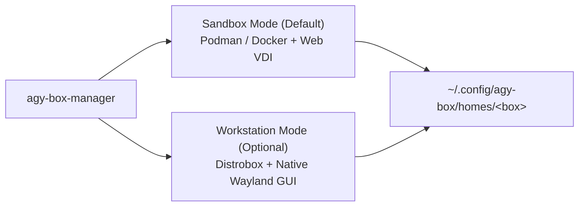

# 📘 Antigravity Dev Box (`agy-box`) — Complete User Guide

Welcome to the definitive user guide for **`agy-box`** (and companion **`agy-easy-install`**), the multi-box AI agent development environment and isolated sandbox fleet for the Google Antigravity ecosystem.

Whether you are building autonomous agents with the **Antigravity SDK**, working in the **`agy` CLI**, editing in **Visual Studio Code** or **Zed**, or running full GUI sessions in the **Web VDI Desktop**, this guide walks you through every step.

---

## 📑 Table of Contents

1. [Quickstart (Zero-to-Hero in 60 Seconds)](#1-quickstart-zero-to-hero-in-60-seconds)
2. [Ways to Work & Workspace Modes](#2-ways-to-work--workspace-modes)
   - [Mode 1: Isolated Sandbox (`--mode sandbox`, Default)](#mode-1-isolated-sandbox---mode-sandbox-default)
   - [Mode 2: Host-Integrated Workstation (`--mode workstation`, Optional)](#mode-2-host-integrated-workstation---mode-workstation-optional)
   - [Browser-Based Web Desktop (noVNC VDI)](#browser-based-web-desktop-novnc-vdi)
   - [Multi-Box Fleet & Smart Box Selection](#multi-box-fleet--smart-box-selection)
3. [AI Model Authentication & Setup](#3-ai-model-authentication--setup)
   - [Personal Google Account (OAuth)](#personal-google-account-oauth)
   - [Gemini API Key](#gemini-api-key)
   - [Enterprise / Google Cloud Vertex AI (GCP ADC)](#enterprise--google-cloud-vertex-ai-gcp-adc)
   - [Local Offline Models](#local-offline-models)
4. [Modern IDE Deep Dive](#4-modern-ide-deep-dive)
   - [Visual Studio Code](#visual-studio-code)
   - [Zed Editor](#zed-editor)
   - [Google Antigravity App](#google-antigravity-app)
5. [Agentic Engineering & CLI Mastery](#5-agentic-engineering--cli-mastery)
   - [The `agy` Command Reference](#the-agy-command-reference)
   - [Slash Commands Guide (`/plan`, `/boost`, `/goal`)](#slash-commands-guide)
   - [Concurrent Subagents](#concurrent-subagents)
   - [Autonomous Browser Automation with Chrome CDP](#autonomous-browser-automation-with-chrome-cdp)
6. [Configuration, Diagnostics, Logging & Maintenance](#6-configuration-diagnostics-logging--maintenance)
   - [Configuration File (`~/.config/agy-box/config.env`)](#configuration-file-configagy-boxconfigenv)
   - [Health Checks (`doctor` & `agy-doctor`)](#health-checks-doctor--agy-doctor)
   - [Structured Tool Logging (`logs`)](#structured-tool-logging-logs)
   - [Updating Environments (`update`)](#updating-environments-update)
   - [Removing Boxes & Managing Preserved Data (`clean`)](#removing-boxes--managing-preserved-data-clean)
7. [Troubleshooting & FAQ](#7-troubleshooting--faq)
8. [Command Reference](#8-command-reference)
9. [Container Health Diagnostics (`agy-doctor`)](#9-container-health-diagnostics-agy-doctor)
10. [Alternative & Cloud Deployments](#10-alternative--cloud-deployments)
11. [Toolchain Reference](#11-toolchain-reference)

---

## 1. Quickstart (Zero-to-Hero in 60 Seconds)

You do **not** need to clone any Git repositories to install and launch `agy-box`.

### Step 1: Launch the Manager
Run this single command in your host terminal:

```bash
bash <(curl -fsSL https://raw.githubusercontent.com/wtg-codes/agy-box/main/agy-box-manager)
```

`agy-box-manager` opens straight into the streamlined TUI menu (or runs headlessly via CLI subcommands):
1. Verifies your container runtime (**Podman** [recommended] or **Docker**; **Distrobox** is optional and only needed for `--mode workstation`).
2. Pulls the multi-arch image (`ghcr.io/wtg-codes/agy-box:latest`) built natively for `x86_64` and `arm64`.
3. Creates a new box with a permanent two-word slug (such as `agy-box-golden-spark`) and a dedicated isolated home at `~/.config/agy-box/homes/<box-name>`.
4. Keeps your host clean: zero edits to `~/.bashrc` or `~/.zshrc`, and zero overwrites of any host `~/.local/bin/agy` binary.

### Step 2: Install the Manager CLI Globally
Inside **System Tools**, select **`🌍 Install CLI Globally (~/.local/bin)`**, or run:
```bash
agy-box-manager install-global
```
This installs `~/.local/bin/agy-box-manager` and tab-completion scripts for `agy-box-manager` (`bash`, `zsh`, and `fish`).

---

## 2. Ways to Work & Workspace Modes



### Mode 1: Isolated Sandbox (`--mode sandbox`, Default)
Every `agy-box-manager install` creates an isolated rootless Podman or Docker container with zero host credential mounts by default (pass `--seed-ssh`, `--seed-git`, `--seed-gcloud`, or set `AGY_PROFILE_SEEDING="true"` in `config.env` for read-only seeding):
```bash
agy-box-manager install
agy-box-manager enter
```

### Mode 2: Host-Integrated Workstation (`--mode workstation`, Optional)
On desktop Linux distributions with `distrobox` installed (such as Bluefin, Bazzite, Fedora, Ubuntu, or Arch), pass `--mode workstation` to forward host Wayland/X11 sockets, audio, and D-Bus SecretService:
```bash
agy-box-manager install --mode workstation
agy-box-manager enter
```
Inside a workstation shell, launching `antigravity`, `code`, `zed`, or `google-chrome-stable` renders native Wayland/X11 windows directly on your host desktop.

### Browser-Based Web Desktop (noVNC VDI)
On any host (local laptop, headless server, DGX Spark, cloud VM, or Chromebook), launch a full browser desktop for any box:
```bash
agy-box-manager desktop
```
Open **`http://127.0.0.1:6080/vnc.html?autoconnect=true&resize=scale&path=websockify`** in your browser. Each additional box automatically receives the next free host port (`6081`, `6082`, ...), or pass `-p <port>` and `-r <WxH>` explicitly. Use `--detach` to start in the background, `--status` to check state, and `--stop` to end the VDI session cleanly.

> [!WARNING]
> Inside the container, noVNC listens without password authentication. On remote machines, access VDI over an SSH tunnel (`ssh -L 6080:127.0.0.1:6080 <host>`) or trusted tailnet rather than exposing port `6080` publicly.

### Multi-Box Fleet & Smart Box Selection
Every box belongs to a channel:
- **`stable` channel** (`agy-box-<adj>-<noun>`): created by `agy-box-manager install`, or by `agy-box-manager dev` when building a local checkout on `main` or a `v*` release tag (`localhost/agy-box:stable`).
- **`dev` channel** (`agy-box-dev-<adj>-<noun>`): created by `agy-box-manager dev` on any non-`main` branch (`localhost/agy-box:dev`) or `--channel dev`.

Box commands (`enter`, `desktop`, `logs`, `update`, `clean`, `doctor`) resolve targets flexibly:
- **Omitted selector** (`agy-box-manager enter`): automatically selects the box when 1 box is installed, or opens an interactive picker when multiple boxes exist.
- **Channel selector** (`agy-box-manager enter stable` or `agy-box-manager enter dev`): selects the matching channel box.
- **Slug shorthand or full name** (`agy-box-manager enter golden-spark` or `agy-box-manager enter agy-box-golden-spark`).
- **One-shot command execution**: `agy-box-manager enter -- agy --version`.

---

## 3. AI Model Authentication & Setup

### Personal Google Account (OAuth)
1. Inside the container shell or Web VDI desktop, run:
   ```bash
   agy
   ```
2. Complete the one-time browser login. Tokens are stored inside the box's isolated home (`~/.gemini/` and `~/.config/Antigravity`).

### Gemini API Key
Export your Google AI Studio key in your container shell or persist it in `~/.config/environment.d/agy-box.conf` inside the box:
```bash
export GEMINI_API_KEY="AIzaSy..."
```

### Enterprise / Google Cloud Vertex AI (GCP ADC)
```bash
gcloud auth application-default login
export GOOGLE_CLOUD_PROJECT="my-enterprise-project-id"
```

### Local Offline Models
Run your model backend (e.g. Ollama or vLLM) on the host or in its own container. If you want a web chat UI, run the official Open WebUI container alongside your boxes.

---

## 4. Modern IDE Deep Dive

### Visual Studio Code
* **Package Origin:** Official Microsoft repository (`amd64` and `arm64`) with container-safe wrapper flags and automatic `--password-store=basic` fallback when host SecretService is isolated or unavailable.
* **Extension:** Ships `/etc/skel/.vscode/extensions.json` recommending `Google.google-antigravity` (install/refresh user-space extensions anytime via `agy-box-manager update --ides`).
* **Launch:** Click **Visual Studio Code** in VDI or run `code .`.

### Zed Editor
* **Package Origin:** Official native release for `amd64` and `arm64`.
* **Extension:** Pre-configured in `~/.config/zed/settings.json` with `"auto_install_extensions": {"antigravity": true}`.
* **Launch:** Click **Zed** in VDI or run `zed .`.

### Google Antigravity App
* **Package Origin:** Pre-baked in `/opt/antigravity` (`/usr/local/bin/antigravity`) with container-safe Electron flags and Chrome CDP wiring.
* **Launch:** Click **Google Antigravity** in VDI or run `antigravity`.

---

## 5. Agentic Engineering & CLI Mastery

### The `agy` Command Reference

| Command / Flag | Purpose |
| :--- | :--- |
| `agy` | Start an interactive agent chat session |
| `agy -p "prompt"` | Run a one-shot headless agent prompt and print the answer |
| `agy --resume` | Resume the most recent conversation |
| `agy --statusline` | Customize the interactive terminal status line |
| `agy --sandbox` | Run in read-only sandbox mode |

### Slash Commands Guide
* **`/plan`**: Formulate a step-by-step implementation plan before editing code.
* **`/boost`**: Activate deep multi-perspective reasoning for complex bugs or architecture.
* **`/learn`**: Persist project-specific conventions or workflow rules.
* **`/goal`**: Work autonomously until a long-running objective is verified complete.

### Concurrent Subagents
Spawn parallel subagents inside your isolated box to audit, refactor, and test independent components concurrently without touching your host filesystem.

### Autonomous Browser Automation with Chrome CDP
`agy-box` ships **Google Chrome** (`amd64`) and **Chromium** (`arm64`) pre-configured for container execution so agents can drive browser workflows over CDP (`9222`).

---

## 6. Configuration, Diagnostics, Logging & Maintenance

### Configuration File (`~/.config/agy-box/config.env`)
Default settings are initialized automatically on first run at `~/.config/agy-box/config.env`:
```bash
AGY_CONTAINER_MANAGER="podman"   # "podman" or "docker"
AGY_DEFAULT_MODE="sandbox"       # "sandbox" (default) or "workstation"
AGY_KEYRING_MODE="host"          # "host" or "isolated" (for workstation mode)
AGY_DEFAULT_IDE="code"           # "code", "zed", or "none"
AGY_PROFILE_SEEDING="false"      # "true" mounts ~/.ssh, ~/.gitconfig, ~/.config/gcloud read-only
AGY_TELEMETRY="false"
```

### Health Checks (`doctor` & `agy-doctor`)
Run host and fleet diagnostics from the host, optionally targeting a running box to execute `/usr/local/bin/agy-doctor` inside it:
```bash
agy-box-manager doctor           # Host runtime, permissions, config, and managed box inventory
agy-box-manager doctor stable    # Also runs non-blocking agy-doctor inside the box
```

**Keyring Behavior**:
- **Sandbox Mode & Isolated Workstation (`AGY_KEYRING_MODE="isolated"`)**: Uses a container-local session `dbus-daemon` and `--password-store=basic` with zero interactive password prompts and zero `EncryptedKeyring` hangs.
- **Host Workstation (`AGY_KEYRING_MODE="host"`)**: Forwards your host desktop's D-Bus SecretService (`org.freedesktop.secrets`), with automatic timeout guards (`--reply-timeout=1500`) if the host keyring is locked.

### Structured Tool Logging (`logs`)
Every external command executed by `agy-box-manager` (`podman`/`docker`, `distrobox`, `agy-vdi`, `agy-install-toolchain`) is logged with UTC timestamps, command arguments, output, elapsed seconds, and exit codes under `~/.config/agy-box/logs/` (`agy-box-manager.log` with 5 MB rotation plus per-box `<box>.log`), alongside container-internal logs in `~/.config/agy-box/homes/<box>/.local/state/agy-box/{doctor,vdi,toolchain,entrypoint}.log`.

```bash
# View manager log + list all available box & container state logs
agy-box-manager logs

# View all host & container logs for a specific box (works even if creation failed!)
agy-box-manager logs golden-spark

# Filter or follow specific container logs
agy-box-manager logs golden-spark --vdi -f
agy-box-manager logs dev --doctor -n 100
```

### Updating Environments (`update`)
Boxes have permanent names and are updated in place:
```bash
agy-box-manager update                  # Updates toolchain, IDE extensions, and OS packages
agy-box-manager update --toolchain      # Updates Antigravity CLI, UI, SDK, ADK, Gemini CLI
agy-box-manager update --ides           # Installs/updates VS Code & Zed Antigravity extensions
agy-box-manager update --packages       # Upgrades Ubuntu apt packages inside the box
agy-box-manager update dev --all        # Updates your dev-channel box
```

### Removing Boxes & Managing Preserved Data (`clean`)
```bash
# Remove a box (prompts whether to purge or keep ~/.config/agy-box/homes/<box>)
agy-box-manager clean golden-spark

# Non-interactive removal with full data purge
agy-box-manager clean golden-spark --purge -y

# Remove ALL managed boxes and their isolated home directories
agy-box-manager clean --all --purge -y
```

---

## 7. Troubleshooting & FAQ

### Q: Where do I look if `install` or `desktop` fails?
Every failure prints the exact diagnostic log path and command, e.g.:
```bash
agy-box-manager logs <box-name>
agy-box-manager logs <box-name> --vdi
```

### Q: GUI applications do not appear on my host desktop
* **Cause:** Your box was created in default `sandbox` mode (which isolates host display sockets), or your host Wayland/X11 compositor blocks local container clients.
* **Fix:** Use `agy-box-manager desktop` to work in the browser VDI desktop, or create a workstation box with `agy-box-manager install --mode workstation` (and run `xhost +local:` if using X11).

### Q: How do I force Docker instead of Podman?
Set `AGY_CONTAINER_MANAGER="docker"` in `~/.config/agy-box/config.env` or export `DBX_CONTAINER_MANAGER="docker"` before running `agy-box-manager`.

---

## 8. Command Reference

| Action | Bash Command | Just Command |
| :--- | :--- | :--- |
| **Interactive Menu** | `agy-box-manager` | `just agy` |
| **Create Stable Box** | `agy-box-manager install [-m sandbox\|workstation] [-i ] [-n <name>] [-y]` | `just agy-install` |
| **Build Box from Repo** | `agy-box-manager dev [-m sandbox\|workstation] [--channel stable\|dev]` | `just agy-box-dev` |
| **Enter Box Shell** | `agy-box-manager enter [box\|stable\|dev] [-- cmd...]` | `just agy-enter` |
| **VDI Web Desktop** | `agy-box-manager desktop [box\|stable\|dev] [-p port] [-r WxH] [-d\|--stop\|--status]` | `just agy-desktop` |
| **View Diagnostic Logs** | `agy-box-manager logs [box\|stable\|dev] [-n N] [-f] [--vdi\|--doctor\|--toolchain\|--manager]` | `just agy-logs` |
| **Status & Storage** | `agy-box-manager status` | `just agy-status` |
| **Health Diagnostics** | `agy-box-manager doctor [box]` (alias `check`) | `just agy-doctor` |
| **In-Place Updater** | `agy-box-manager update [box\|stable\|dev] [--all\|--toolchain\|--ides\|--packages\|--check]` | `just agy-update` |
| **Clean Box / Fleet** | `agy-box-manager clean [box\|stable\|dev\|--all] [--purge\|--keep] [-y]` | `just agy-clean` |
| **Update Toolchain Only** | `agy-box-manager update-toolchain [box\|stable\|dev]` | `just agy-update-toolchain` |
| **Global CLI Install** | `agy-box-manager install-global` | `just agy-install-global` |
| **Global CLI Uninstall** | `agy-box-manager uninstall-global [-y]` | `just agy-uninstall-global` |
| **Run Integration Tests** | `agy-box-manager test` | `just agy-test` |
| **E2E Published Image Test** | *N/A (justfile only)* | `just agy-e2e [tag]` |
| **Assert Running Box** | *N/A (justfile only)* | `just agy-assert [box]` |
| **Run Bats Unit Tests** | *N/A (justfile only)* | `just test-scripts` |
| **Prune Unused Containers** | *N/A (justfile only)* | `just agy-prune` |
| **Show Version** | `agy-box-manager version` | *N/A* |

---

## 9. Container Health Diagnostics (`agy-doctor`)

Container shells open instantaneously with zero login-blocking setup wizards. Whenever you want to verify container internals, run `agy-doctor` inside the box (or `agy-box-manager doctor <box>` from the host):

1. **Non-Blocking TTY-Detached Probes**: Runs every check inside `setsid -w` with `</dev/null` and strict `timeout -k 1` deadlines so hung tools or D-Bus calls can never freeze your terminal.
2. **Keyring & SecretService Verification**: Probes Python keyring backend and D-Bus `org.freedesktop.secrets` (`--reply-timeout=1500` + 3s `SIGALRM`), detecting locked host keyrings or unconfigured backends in milliseconds without prompting for passwords.
3. **Toolchain, Browser & Git Checks**: Verifies `agy`, `antigravity`, `adk`, `gemini`, Chrome/Chromium wrapper health, and non-root execution, recording structured output to `~/.local/state/agy-box/doctor.log`.

---

## 10. Alternative & Cloud Deployments

`agy-box` is a standard multi-arch OCI image (`ghcr.io/wtg-codes/agy-box:latest`, `linux/amd64` and `linux/arm64`) that runs anywhere.

> [!NOTE]
> Outside Distrobox, `/usr/local/bin/entrypoint.sh` configures `agyuser` (`UID/GID 9000` by default, override via `PUID`/`PGID`) with passwordless `sudo` (`/etc/sudoers.d/agyuser`), logs initialization to `~/.local/state/agy-box/entrypoint.log`, and runs `sleep infinity`. Start the desktop with `agy-vdi` or update tools with `agy-install-toolchain`.

### Cloud Virtual Machines (GCP, AWS, Azure, OCI Ampere)
```bash
docker run -d \
  --name agy-box-cloud \
  -p 127.0.0.1:6080:6080 \
  --security-opt label=disable \
  ghcr.io/wtg-codes/agy-box:latest

docker exec -d -u agyuser -w /home/agyuser agy-box-cloud agy-vdi
```
Connect via SSH tunnel (`ssh -L 6080:127.0.0.1:6080 <vm>`) and open `http://127.0.0.1:6080/vnc.html?autoconnect=true&resize=scale&path=websockify`.

### Cloud IDE Platforms (GitHub Codespaces, Coder, Gitpod)
This repository includes [`.devcontainer/devcontainer.json`](../.devcontainer/devcontainer.json):
```json
{
  "name": "Antigravity Cloud Sandbox",
  "image": "ghcr.io/wtg-codes/agy-box:latest",
  "forwardPorts": [6080, 9222]
}
```

---

## 11. Toolchain Reference

The Antigravity toolchain is **pre-baked system-wide** into `/opt` and `/usr/local/bin` during image build via `agy-install-toolchain --system` ([`scripts/install-agent-toolchain.sh`](../scripts/install-agent-toolchain.sh)), and can be updated per box into `~/.local` via `agy-install-toolchain` (logging to `~/.local/state/agy-box/toolchain.log`).

### Google Antigravity (Agent UI)
* **Install:** `/opt/antigravity` → `/usr/local/bin/antigravity` (`2.31.0`, SHA-256 verified for `x64` and `arm64`).
* **Wrapper:** Launches with container-safe flags (`--disable-dev-shm-usage --disable-gpu --no-sandbox`), `--password-store=basic` fallback when host SecretService is isolated/unavailable, and Chrome CDP integration.

### Antigravity CLI (`agy`)
* **Path:** `/usr/local/bin/agy` (`1.5.5`, updated per user in `~/.local/bin/agy`). Executed inside the box via `agy-box-manager enter` (`agy-box-manager` never overwrites `~/.local/bin/agy` on your host).

### Antigravity SDK (`google-antigravity`) & Google ADK
* **Origin:** PyPI (`google-antigravity==0.1.23`, `google-adk==2.1.0`), installed with pinned `uv` into `/opt/agy-python`.

### Gemini CLI & CNCF Tooling
* **Gemini CLI** (`@google/gemini-cli@0.43.0`, `gemini`) and checksum-verified **`kubectl`, `helm`, `k9s`** ([`scripts/install-tools.sh`](../scripts/install-tools.sh)).
